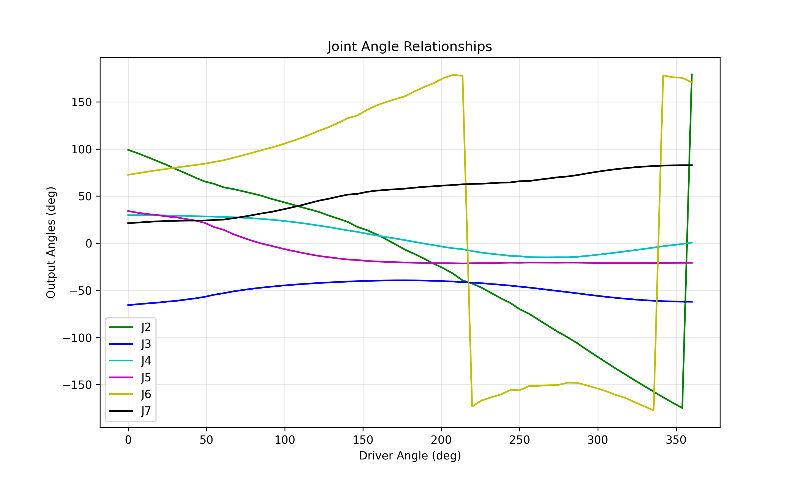

## 第二章 参数化显式分支与傅里叶拟合

### 2.1 参数化 MDH 描述

这部分机构是一个平面对称的空间 7R 闭链。为了让理论推导和数值仿真保持一致，几何参数统一写成最短杆长 `l` 的倍数：`l` 是最短杆长，`2l` 是中间杆长，`2.5l` 是最长杆长。数值仿真时取 `l = 40 mm`，因此 `2l = 80 mm`，`2.5l = 100 mm`。

按修正后的 MDH 参数，关节 1 到 7 的参数可写成：

| 关节 | `alpha_{i-1}` | `a_{i-1}` | `d_i` | `theta_{i,0}` |
| --- | --- | --- | --- | --- |
| 1 | `0°` | `l` | `0` | `0°` |
| 2 | `90°` | `2l` | `2.5l` | `0°` |
| 3 | `90°` | `0` | `0` | `180°` |
| 4 | `90°` | `2.5l` | `0` | `0°` |
| 5 | `90°` | `2.5l` | `0` | `0°` |
| 6 | `90°` | `0` | `2.5l` | `180°` |
| 7 | `90°` | `2l` | `0` | `0°` |

这里要特别注意，程序里使用的索引顺序和论文里的物理编号要统一。最终按你确认的映射写成：程序里的 `(1,3,5,7)` 对应论文里的 `(2,4,6,1)`。

### 2.2 显式分支推导

在选定分支上，可以把机构写成一个显式参数曲线。设

$$
 l_0 = l,\qquad a = 2l,\qquad b = 2.5l,
$$
$$
 l_1 = l_3 = \sqrt{a^2+b^2},\qquad l_2 = 2a + l = 5l,
$$
并定义

$$
\beta = \operatorname{atan2}(b,a).
$$

把 `\theta_1` 作为分支参数，则有

$$
\phi_1 = \theta_1 - \beta,
$$
$$
\mathbf p_3 =
\begin{bmatrix}
 l_1\cos\phi_1 \\
 l_1\sin\phi_1
\end{bmatrix},
$$
$$
 d = \sqrt{(l_1\cos\phi_1-l_0)^2 + (l_1\sin\phi_1)^2}.
$$

闭环三角形中的几何角为

$$
\alpha = \operatorname{atan2}(l_1\sin\phi_1,\; l_1\cos\phi_1-l_0),
$$
余弦定理给出

$$
\gamma = \arccos\left(\frac{l_3^2+d^2-l_2^2}{2l_3d}\right).
$$

于是

$$
\phi_3 = \alpha - \gamma.
$$

剩余关节协调关系可写成

$$
\theta_3 = \theta_1 - \phi_2 + \pi,\qquad
\theta_5 = \phi_3 - \phi_2 - \beta,\qquad
\theta_7 = \pi + \beta - \phi_3,
$$
其中

$$
\phi_2 = \operatorname{atan2}(l_3\sin\phi_3 - l_1\sin\phi_1,\; l_0 + l_3\cos\phi_3 - l_1\cos\phi_1).
$$

这说明在该分支上，机构可以写成一个以 `\theta_1` 为参数的显式表达。若改成以 `\theta_7` 为输入，则 `\theta_1(\theta_7)` 更适合通过连续延拓数值求解，而不是强行写成一个很长的闭式反解。

### 2.3 数值求解和 Fourier 拟合

当输入角指定为 `\theta_7` 时，采用包角残差做一维优化：

$$
\Delta(\theta_1) = \operatorname{atan2}\Big(\sin(\theta_7(\theta_1)-\theta_7^\star),\; \cos(\theta_7(\theta_1)-\theta_7^\star)\Big),
$$
$$
\theta_1^\star = \arg\min_{\theta_1} \Delta(\theta_1)^2.
$$

求解时以上一个采样点的收敛解作为下一步初值，这样可以稳定地沿同一分支延拓，不会跳到另一条装配支路。

把整条曲线求出来以后，对各关节角做展开，并减去初始位形：

$$
\Delta\theta_i = \operatorname{unwrap}(\theta_i) - \operatorname{unwrap}(\theta_i)\big|_{\theta_7=\theta_{7,0}},\qquad i\in\{1,3,5,7\}.
$$

然后用截断 Fourier 级数拟合：

$$
\widehat{\Delta\theta_i}(\Delta\theta_7)=c_{i,0}+\sum_{k=1}^{K}\big[c_{i,k}\cos(k\Delta\theta_7)+s_{i,k}\sin(k\Delta\theta_7)\big].
$$

这样做的好处是：表达紧凑、连续、光滑，后面课程学习和 PPO 训练时可以直接把它当成关节协调参考。

### 2.4 关节角曲线

下图是数值延拓得到的关节角关系曲线。它说明在同一分支上，其他关节角会随着输入角连续变化，且 Fourier 拟合和数值曲线能很好地重合。

图中的序列对应程序索引 `(1,3,5,7)`，按最终编号映射后写成论文里的 `(2,4,6,1)`。

### 2.5 论文里建议直接写的结论句

可以直接写成下面这句：

> 该分支在参数化 MDH 模型下可写成以 `\theta_1` 为参数的显式曲线；当输入角改写为 `\theta_7` 时，则通过连续延拓恢复 `\theta_1(\theta_7)`，并进一步用截断 Fourier 级数对关节协调关系进行紧凑拟合。

