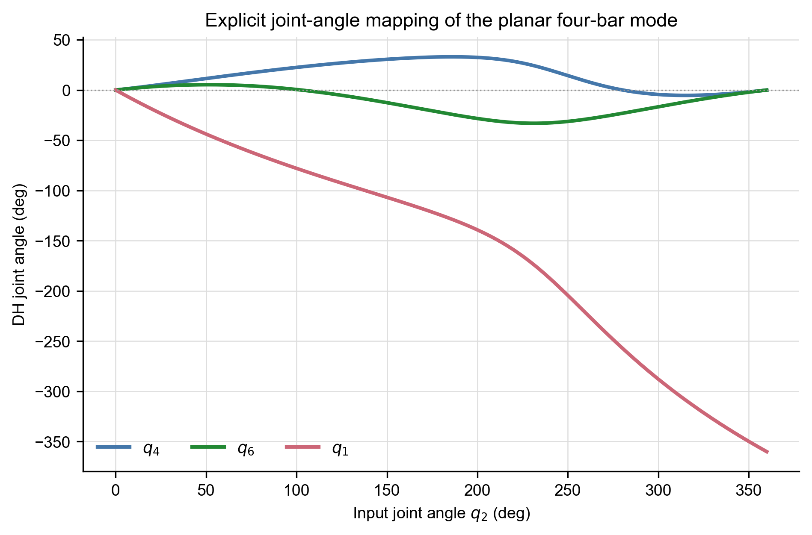
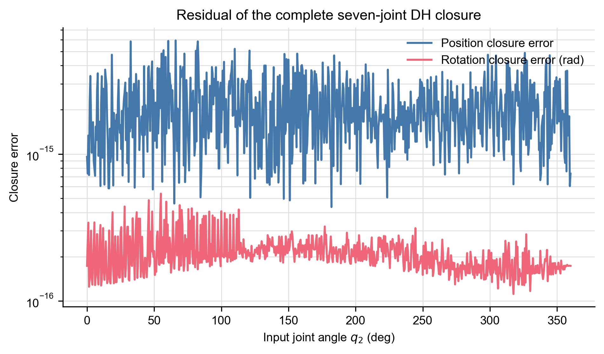
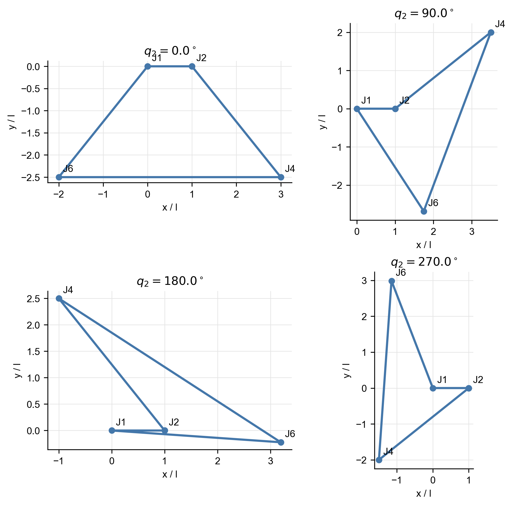
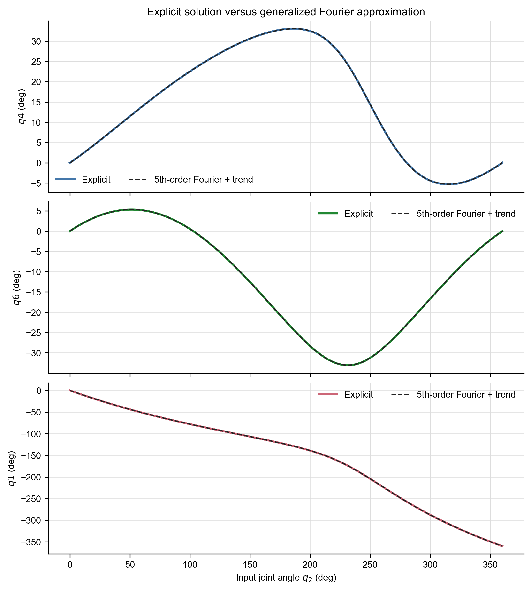
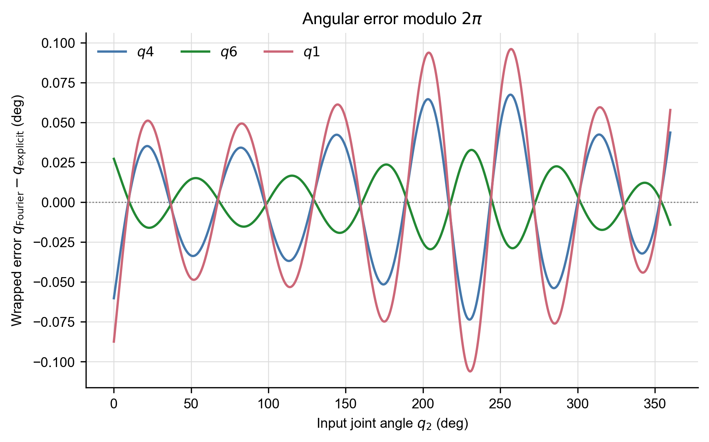

# 七杆闭链机构中 2–4–6–1 平面四杆模式的显式解与傅里叶拟合报告

## 摘要

本文针对一类七转动关节闭链机构，研究关节 3、5、7 锁定在初始角度、关节 2、4、6、1 保持轴线平行时形成的平面四杆运动模式。计算严格沿用原程序中的改进 DH 变换，并以零关节变量构型为初始闭环姿态。通过提取四根活动轴的轴心，空间闭环被约化为平面四杆的两圆交点问题，由此获得关节 4、6、1 关于输入角 \(q_2\) 的几何显式解。该解在 \(q_2\in[0,2\pi]\) 的 721 个采样点上全部可达，代回完整七杆 DH 闭环后的最大位置误差为 \(5.930\times10^{-15}\)，最大姿态误差为 \(5.376\times10^{-16}\,\mathrm{rad}\)。进一步采用含线性斜率项的五阶傅里叶级数拟合显式解。三个活动从动关节的最大角误差不超过 \(0.1061^\circ\)，说明该模型可作为高精度工程近似，但并非与显式解数学等价。

## 1. 问题定义

七杆机构的 DH 参数按

\[
[\alpha_{r-1},a_{r-1},d_r,\theta_{r,\mathrm{offset}}]
\]

排列。这里只改变关节名称，后续变换矩阵中的 \(r=1,\ldots,7\) 仍表示闭环连乘的链位置；链位置对应的新关节编号依次为 \(2,3,4,5,6,7,1\)：

| 新关节编号 | \(\alpha\) | \(a\) | \(d\) | \(\theta_{\mathrm{offset}}\) |
|---:|---:|---:|---:|---:|
| 2 | \(0\) | \(l\) | \(0\) | \(0\) |
| 3 | \(\pi/2\) | \(2l\) | \(2.5l\) | \(0\) |
| 4 | \(\pi/2\) | \(0\) | \(0\) | \(\pi\) |
| 5 | \(\pi/2\) | \(2.5l\) | \(0\) | \(0\) |
| 6 | \(\pi/2\) | \(2.5l\) | \(0\) | \(0\) |
| 7 | \(\pi/2\) | \(0\) | \(2.5l\) | \(\pi\) |
| 1 | \(\pi/2\) | \(2l\) | \(0\) | \(0\) |

实际 DH 转角为

\[
\theta_r=q_{\nu(r)}+\theta_{r,\mathrm{offset}},\qquad \nu(r)=(2,3,4,5,6,7,1)_r.
\]

初始关节变量取

\[
\mathbf q_0=[0,0,0,0,0,0,0]^{\mathsf T}.
\]

因此，第 4、7 关节的初始实际 DH 转角仍包含参数表中的 \(\pi\) 偏置。平面模式中，锁定条件的一般形式为

\[
q_3=q_{3,0},\qquad q_5=q_{5,0},\qquad q_7=q_{7,0},
\]

本算例恰有 \(q_{3,0}=q_{5,0}=q_{7,0}=0\)。

## 2. 改进 DH 闭环

程序采用的单节变换为

\[
{}^{r-1}T_r=
\begin{bmatrix}
\cos\theta_r&-\sin\theta_r&0&a_{r-1}\\
\sin\theta_r\cos\alpha_{r-1}&
\cos\theta_r\cos\alpha_{r-1}&
-\sin\alpha_{r-1}&
-d_r\sin\alpha_{r-1}\\
\sin\theta_r\sin\alpha_{r-1}&
\cos\theta_r\sin\alpha_{r-1}&
\cos\alpha_{r-1}&
d_r\cos\alpha_{r-1}\\
0&0&0&1
\end{bmatrix}.
\]

完整闭环条件为

\[
T_{\mathrm{end}}(\mathbf q)
=\prod_{r=1}^{7}{}^{r-1}T_r=I_4.
\]

初始构型的 Frobenius 范数闭环误差约为

\[
\|T_{\mathrm{end}}(\mathbf q_0)-I_4\|_F
=9.87\times10^{-16},
\]

因此该构型可以作为解析运动的出发位置。

## 3. 平面四杆约化

按照改进 DH 变换的实际转轴位置计算关节轴心，关节 2、4、6、1 在初始公共平面内的坐标为

\[
P_2=(1,0),\quad
P_4=(3,-2.5),\quad
P_6=(-2,-2.5),\quad
P_1=(0,0).
\]

对应四杆长度为

\[
L_{24}=L_{61}=\frac{\sqrt{41}}{2}l,\qquad
L_{46}=5l,\qquad
L_{12}=l.
\]

以关节 2 的轴线方向为公共平面法向，四根活动轴的方向符号为

\[
[\sigma_2,\sigma_4,\sigma_6,\sigma_1]
=[1,-1,1,1].
\]

该符号用于把平面杆件方向变化换算回原七杆机构的 DH 关节角。

## 4. 轴心位置的显式解

令输入增量为

\[
\Delta q_2=q_2-q_{2,0}.
\]

关节 4 的轴心随输入杆绕 \(P_2\) 转动：

\[
P_4(q_2)
=P_2+R(\sigma_2\Delta q_2)(P_{4,0}-P_2),
\]

其中二维转动矩阵为

\[
R(\psi)=
\begin{bmatrix}
\cos\psi&-\sin\psi\\
\sin\psi&\cos\psi
\end{bmatrix}.
\]

关节 6 的轴心同时满足

\[
\|P_6-P_4\|=L_{46},\qquad
\|P_6-P_1\|=L_{61}.
\]

定义

\[
D=\|P_1-P_4\|,\qquad
\mathbf e=\frac{P_1-P_4}{D},\qquad
\mathbf e_\perp=(-e_y,e_x),
\]

则两圆交点显式写为

\[
P_6=P_4+x\mathbf e+s\,h\mathbf e_\perp,
\]

其中

\[
x=\frac{L_{46}^{2}-L_{61}^{2}+D^{2}}{2D},
\qquad
h=\sqrt{L_{46}^{2}-x^{2}},
\qquad
s\in\{-1,+1\}.
\]

正负号 \(s\) 对应两条装配支路。比较 \(q_2=q_{2,0}\) 时两个候选交点与初始 \(P_{6,0}\) 的距离，可确定本算例采用

\[
s=+1.
\]

当 \(h^2<0\) 时，两圆无实交点，对应输入角不可达。本算例整周计算中没有出现不可达点。

## 5. DH 关节角显式回映射

由轴心坐标定义三根活动杆的绝对方向：

\[
\phi_{24}=\operatorname{atan2}(P_{4y}-P_{2y},P_{4x}-P_{2x}),
\]

\[
\phi_{46}=\operatorname{atan2}(P_{6y}-P_{4y},P_{6x}-P_{4x}),
\]

\[
\phi_{61}=\operatorname{atan2}(P_{1y}-P_{6y},P_{1x}-P_{6x}).
\]

记 \(\Delta\phi_{jk}=\phi_{jk}-\phi_{jk,0}\)，并沿运动序列连续展开角度，则

\[
\Delta q_4
=\frac{\Delta\phi_{46}-\sigma_2\Delta q_2}{\sigma_4},
\]

\[
\Delta q_6
=\frac{\Delta\phi_{61}
-\sigma_2\Delta q_2
-\sigma_4\Delta q_4}{\sigma_6},
\]

\[
\Delta q_1
=-\frac{\sigma_2\Delta q_2
+\sigma_4\Delta q_4
+\sigma_6\Delta q_6}{\sigma_1}.
\]

代入本算例的轴方向符号，可得

\[
q_4(q_2)=\Delta q_2-\Delta\phi_{46},
\]

\[
q_6(q_2)=\Delta\phi_{61}-\Delta q_2+q_4,
\]

\[
q_1(q_2)=-\Delta q_2+q_4-q_6.
\]

这里的 \(\phi_{jk}\) 已由上述两圆交点公式显式给出，因此三式构成关于输入角 \(q_2\) 的闭式几何表达，而不是数值优化或曲线拟合结果。

## 6. 数值结果与完整闭环验证

在 \(q_2\in[0,2\pi]\) 上均匀选取 721 个采样点，所有输入角均存在当前装配支路的实数解。代表位置如下：

| \(q_2\) | \(q_4\) | \(q_6\) | \(q_1\) |
|---:|---:|---:|---:|
| \(0^\circ\) | \(0^\circ\) | \(0^\circ\) | \(0^\circ\) |
| \(45^\circ\) | \(10.289^\circ\) | \(5.234^\circ\) | \(-39.945^\circ\) |
| \(90^\circ\) | \(20.521^\circ\) | \(2.257^\circ\) | \(-71.736^\circ\) |
| \(135^\circ\) | \(28.609^\circ\) | \(-8.021^\circ\) | \(-98.369^\circ\) |
| \(180^\circ\) | \(32.990^\circ\) | \(-22.335^\circ\) | \(-124.675^\circ\) |
| \(225^\circ\) | \(26.868^\circ\) | \(-32.856^\circ\) | \(-165.276^\circ\) |
| \(270^\circ\) | \(4.010^\circ\) | \(-26.272^\circ\) | \(-239.717^\circ\) |
| \(315^\circ\) | \(-5.318^\circ\) | \(-11.849^\circ\) | \(-308.469^\circ\) |
| \(360^\circ\) | \(0^\circ\) | \(0^\circ\) | \(-360^\circ\) |

将每组显式解代回完整七杆 DH 矩阵，得到

\[
\max e_p=5.930\times10^{-15},
\qquad
\max e_R=5.376\times10^{-16}\ \mathrm{rad}.
\]

误差处于双精度浮点舍入量级，表明显式解与完整空间 DH 闭环一致。

## 7. 带斜率五阶傅里叶拟合

由于 \(q_1\) 在输入转动一周后累计变化约 \(-2\pi\)，普通周期傅里叶级数不能直接表示该绕行数。采用含线性斜率项的广义五阶傅里叶模型：

\[
\widehat q_i(x)=c_{0,i}+c_{1,i}x+
\sum_{k=1}^{5}
\left[a_{k,i}\cos(kx)+b_{k,i}\sin(kx)\right],
\qquad x=q_2.
\]

拟合系数单位为弧度：

| 关节 | \(c_0\) | \(c_1\) | \(a_1\) | \(b_1\) | \(a_2\) | \(b_2\) |
|---|---:|---:|---:|---:|---:|---:|
| \(q_4\) | 0.256376 | 0.000288 | -0.299473 | 0.126236 | 0.036554 | 0.060048 |
| \(q_6\) | -0.204336 | -0.000115 | 0.203030 | 0.253558 | 0.007546 | -0.033653 |
| \(q_1\) | 0.460713 | -0.999597 | -0.502502 | -0.127322 | 0.029009 | 0.093701 |

其余三至五阶系数见 `fourier_comparison/fourier_coefficients.csv`。

拟合误差为：

| 关节 | RMSE | 最大绝对误差 | \(R^2\) |
|---|---:|---:|---:|
| \(q_4\) | \(0.03453^\circ\) | \(0.07361^\circ\) | 0.999993447 |
| \(q_6\) | \(0.01519^\circ\) | \(0.03274^\circ\) | 0.999998684 |
| \(q_1\) | \(0.04954^\circ\) | \(0.10609^\circ\) | 0.999999771 |

将傅里叶拟合角代回完整七杆 DH 方程，最大位置闭环误差为

\[
4.4047\times10^{-3}l,
\]

最大姿态闭环误差为

\[
5.2619\times10^{-15}\ \mathrm{rad}.
\]

姿态误差仍接近零，是因为四个活动关节角之间的总转角关系被线性基函数保持；位置误差不为零，说明有限阶傅里叶模型没有严格满足两圆位置闭环。

## 8. 结论与使用边界

1. 锁定关节 3、5、7 后，关节 2、4、6、1 的运动可由平面四杆两圆交点显式求解。
2. 得到的关节角不是平面杆件绝对角，而是经过轴方向符号换算后的原七杆 DH 变量。
3. 显式解代回完整七杆 DH 方程后的误差处于 \(10^{-15}\) 量级，可作为严格运动学解使用。
4. 带斜率五阶傅里叶级数与显式解在图像上高度重合，最大角误差约 \(0.1061^\circ\)，可用于快速估计、控制器近似或曲线表达。
5. 傅里叶式并非与显式解完全相同。涉及精确闭环、奇异性分析或高精度轨迹生成时，应优先采用几何显式解。

## 9. 结果文件

- 显式解逐点数据：`explicit_solution/joint_angles.csv`
- 显式解矢量图：`explicit_solution/joint_angle_mapping.pdf`、`joint_angle_mapping.svg`
- 傅里叶逐点对比：`fourier_comparison/explicit_vs_fourier.csv`
- 傅里叶完整系数：`fourier_comparison/fourier_coefficients.csv`
- 傅里叶误差指标：`fourier_comparison/fourier_error_metrics.csv`
- 程序目录：`E:\hub\planar_fourbar_dh`

