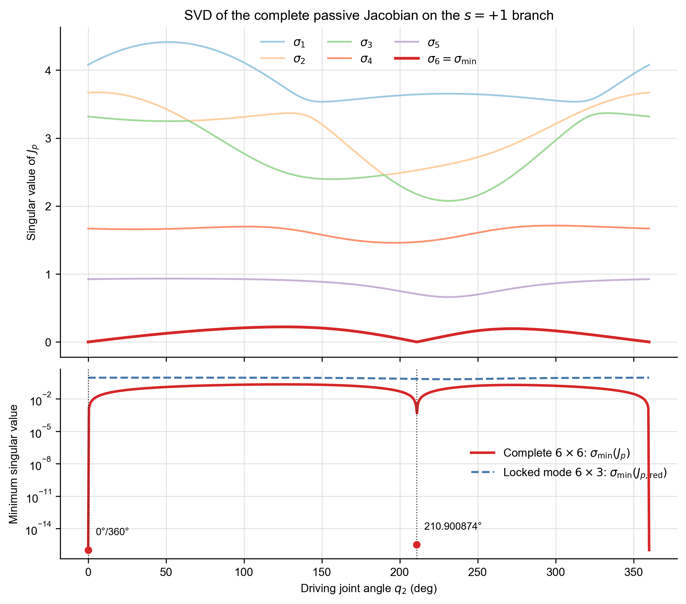

# 基于 SVD 的七关节闭链机构奇异性分析

## 1. SVD 方法简介

对任意矩阵 $A\in\mathbb R^{m\times n}$，奇异值分解写为

$$
A=U\Sigma V^{\mathsf T},
$$

其中 $U$ 与 $V$ 为正交矩阵，$\Sigma$ 的对角元满足

$$
\sigma_1\ge\sigma_2\ge\cdots\ge\sigma_r\ge0.
$$

最小奇异值刻画矩阵距离秩亏的程度。当方阵的
$\sigma_{\min}=0$ 时，矩阵不满秩；当其接近零时，速度映射病态，
机构接近奇异构型。

## 2. 完整闭环速度方程

纯编号替换后的链位置标签依次为

$$
(2,3,4,5,6,7,1).
$$

第 $j$ 个转动关节对闭环末端速度的 Jacobian 列为

$$
J_j=
\begin{bmatrix}
\mathbf z_j\times(\mathbf p_e-\mathbf p_j)\\
\mathbf z_j
\end{bmatrix}.
$$

完整闭环速度约束为

$$
J\dot{\mathbf q}=0.
$$

以新 $q_2$ 为驱动关节，将其列记为 $J_a$，其余六列组成

$$
J_p=
\left[
J_{q_3}\;
J_{q_4}\;
J_{q_5}\;
J_{q_6}\;
J_{q_7}\;
J_{q_1}
\right]\in\mathbb R^{6\times6}.
$$

于是

$$
J_p\dot{\mathbf q}_p=-J_a\dot q_2.
$$

当 $\det(J_p)=0$ 或 $\sigma_6(J_p)=0$ 时，被动速度不能由给定
$\dot q_2$ 唯一确定，完整七关节闭链机构处于奇异构型。

## 3. 当前 $s=+1$ 运动分支的结果

对 $q_2\in[0,360^\circ]$ 扫描，并对行列式变号区间使用 Brent 法精确求根。
检测到的奇异构型如下：

| $q_2$ (deg) | $q_1$ (deg) | $q_4$ (deg) | $q_6$ (deg) | $\sigma_{\min}(J_p)$ | rank |
|---:|---:|---:|---:|---:|---:|
| 0/360（周期边界） | 0.000000 | 0.000000 | 0.000000 | 5.000e-17 | 5 |
| 210.900874173 | -149.099126 | 30.900874 | -30.900874 | 3.196e-16 | 5 |

$0^\circ$ 与 $360^\circ$ 是同一个周期构型，因此只计作一个独立奇异位置。
内部奇异位置为

$$
q_2=210.900874173^\circ.
$$

## 4. 与锁定后约化 Jacobian 的区别

在指定平面运动模式中，新关节 $q_3,q_5,q_7$ 被锁死。仅保留实际运动的
$q_4,q_6,q_1$ 时，

$$
J_{p,\mathrm{red}}=
\left[J_{q_4}\;J_{q_6}\;J_{q_1}\right]
\in\mathbb R^{6\times3}.
$$

该矩阵整周最小奇异值为 0.661314604，出现在
$q_2\approx231.500^\circ$，始终大于零。这表示锁定后的
一自由度四杆轨迹本身没有丢失列秩；但若从完整七关节闭链机构的潜在被动
运动空间考察，$J_p$ 仍在上述两个构型处降秩。

## 5. 结论

1. 完整 $6\times6$ 被动 Jacobian 是本报告判定七关节机构奇异性的主判据。
2. 当前 $s=+1$ 分支存在两个周期表示的零点：$0^\circ/360^\circ$ 和
   $210.900874173^\circ$。
3. 稀疏采样可能只能得到约 $0.0015$ 的最小值；行列式求根表明真实最小
   奇异值处于 $10^{-16}$ 数值量级。
4. $6\times3$ 约化结果不能替代完整机构奇异性分析，但可用于说明锁定后的
   平面运动映射仍保持满列秩。
